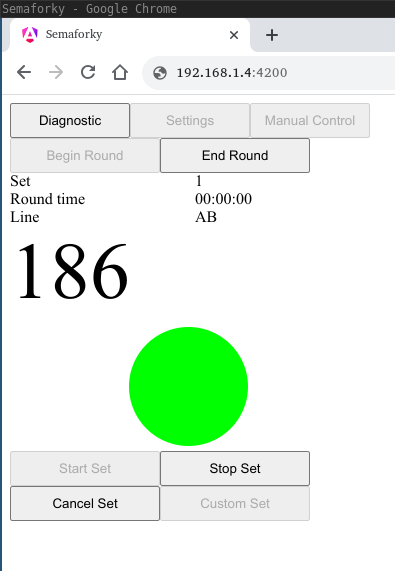
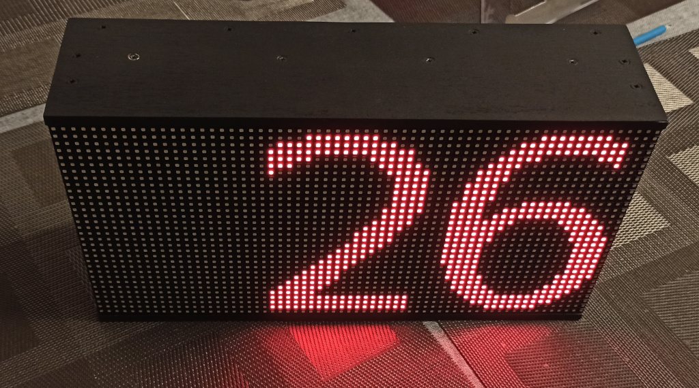
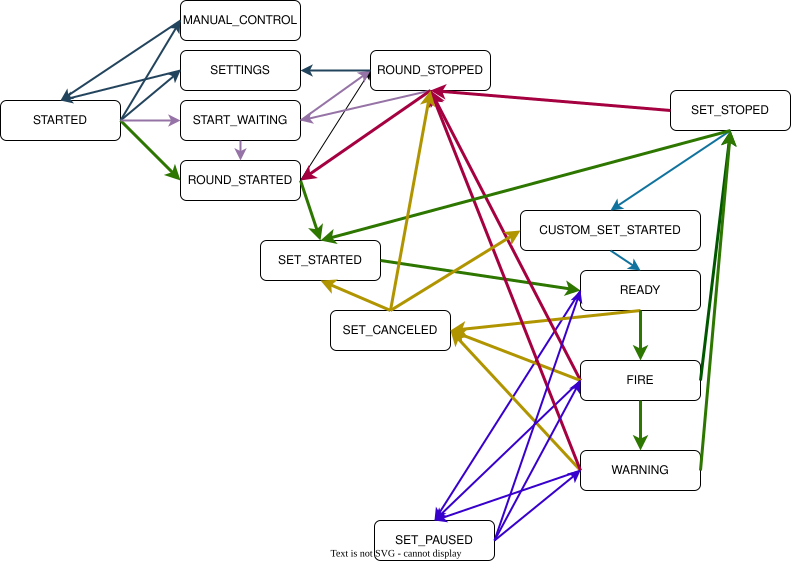

# semaforky webui
Android/Arduino-based hardware controlled via SPA (single page application) web app from any web browser (smartphone, tablet, laptop, PC, Mac, Windows, Linux, ...).

## Motivation

Any Web Browser          |  Hardware running REST/WEB server
:-:|:-:
  |  

## Documentation

[User Guide](UserGuide_cz.md) (in czech)

## Live demo

See [Live demo](http://vajicek.github.io/semaforky).

## Prerequisites

* Docker
* A host user with permission to access the device used for flashing
* A serial device such as `/dev/ttyUSB0` for firmware upload

The Docker development container provides Node.js 22, Angular 22, Arduino CLI,
the pinned ESP8266 toolchain, and `mkspiffs`. Generated frontend and filesystem
files are build artifacts and are not required in source control.

The Arduino dependencies installed by `make install_deps` are:

* ESP8266 board core 3.1.2
* [ESPAsyncTCP](https://github.com/me-no-dev/ESPAsyncTCP)
* [ESPAsyncWebServer](https://github.com/me-no-dev/ESPAsyncWebServer)
* [ArduinoJson](https://github.com/bblanchon/ArduinoJson)
* [DMD2](https://github.com/freetronics/DMD2)
* [Adafruit GFX Library](https://github.com/adafruit/Adafruit-GFX-Library)
* [Adafruit BusIO](https://github.com/adafruit/Adafruit_BusIO)
* Fork of [PxMatrix](https://github.com/vajicek/PxMatrix) with the additional scan pattern

## Use Docker development container

Run these commands from this directory (`web_app`). Build the Docker image:
```bash
make build_devcontainer
```

Use `make rebuild_devcontainer` when the image must be rebuilt without cache.

Run the Docker development container:
```bash
make devcontainer
```

The container is removed when the shell exits. Arduino CLI data and libraries
are kept in Docker named volumes. To expose a serial device to the container:
```bash
make devcontainer DOCKER_DEVICE=/dev/ttyUSB0
```

### Web application

Install the locked frontend dependencies and build the **web app**:
```bash
make build
```

Run the Angular development server on port 4200:
```bash
make setup_ng && make serve_ng
```

The project uses Angular 22 and Node.js 22. Browser-based Karma tests are not
included in the Docker image; run `make test` only in an environment with a
compatible browser.

### Device application

Install the pinned dependencies for the **device application**:
```bash
make install_deps
```

Build and install the **device application**, for example for a p5 device:
```bash
make install_p5
```

Build the filesystem image for the web app server:
```bash
make build-fs
```

Flash the filesystem to the configured device. Set `DEVICE` when it is not
`/dev/ttyUSB0`:
```bash
make flash-fs DEVICE=/dev/ttyUSB0
```

Remove generated output:
```bash
make clean
```

## Semaforky application state diagram



## List of features

* The device will connect to the ESSID 'semaforky' if it exists, or create it if not. This provides flexibility to choose which device acts as the hotspot, or to use a separate router.
* Operations divided into rounds (e.g. training + two halves, FITA 900 - 60m/50m/40m) and rounds into sets (e.g. 10 or 12 sets).
* Scan - gather all devices on given network (specified by Network option). Display number of clients and capabilities (semaphore, siren, line indicator, clock) provided.
* Configurable number of lines - 1 or 2
* Configurable lines rotations - SIMPLE (round 1: AB CD, AB CD, ..; round 2: CD AB, CD AB, ..), ALTERNATING (AB CD, CD, AB, AB, ..)
* Configurable set time, waiting time and warning time.
* Delayed start - set time of start and it will automatically start the first set while showing countdown to start.
* Configurable brightness of all devices.
* Optional sound coming from application. Usable in combination with bluetooth speaker.
* Store configuration in cookies.
* Store state in cookies - should survive page refresh.
* Set cancel (It is like set stop but without incrementing set counter).
* Set pause and resume.
* Manual control for testing purposes (audio, semaphore, clock).
